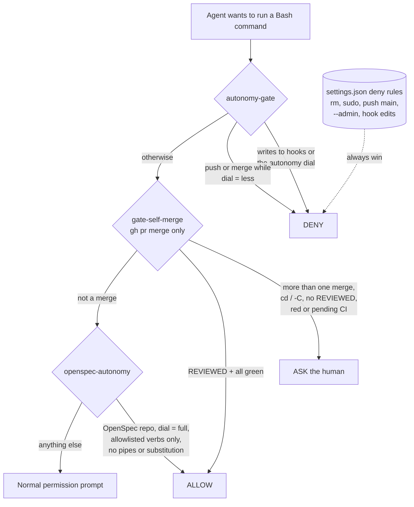
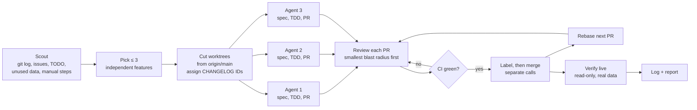
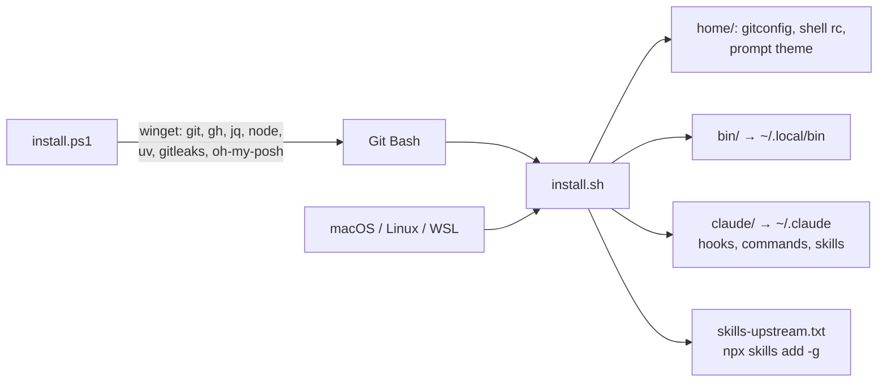

# do no work

A Claude Code setup built so the agent does the work and you make the decisions. It ships with guardrails that make it safe to let the agent run.

Built by Nathaniel Tran. See more of my work at **[ngtran.dev](https://ngtran.dev)**.

It includes hooks, slash commands, skills, a `CLAUDE.md` template, the CLI scripts I use daily, and shell/git config. There is one installer for macOS/Linux/WSL and one for Windows.

- [The workflow](#the-workflow)
- [Guardrails](#guardrails)
- [autobuild: hands-off feature loop](#autobuild-hands-off-feature-loop)
- [Install](#install)
- [What's in it](#whats-in-it)

## The workflow

Every change goes the same way: plan, isolate, prove, review, merge. Each step leaves evidence the next one checks. Hooks enforce the steps; nobody has to remember them.

```mermaid
flowchart LR
    A([Session start]) --> B[session-context hook<br/>loads daily log, todo,<br/>repo HANDOFF]
    B --> C{Non-trivial?<br/>more than 3 files}
    C -- yes --> D[Plan<br/>OpenSpec change or PLAN.md]
    C -- no --> E
    D --> E[Worktree + branch<br/>never the primary checkout]
    E --> F[TDD<br/>failing test, code, green]
    F --> G[Lint + typecheck<br/>gitleaks pre-commit]
    G --> H[Push + PR<br/>What / Why / Proof /<br/>Risk + rollback]
    H --> I[Review<br/>post-PR hook or reviewer agent]
    I --> J{REVIEWED label<br/>and CI green?}
    J -- no --> F
    J -- yes --> K[gate-self-merge<br/>allows squash merge]
    K --> L[Release / deploy<br/>where the repo allows it]
    L --> M["/log<br/>daily log, CHANGELOG,<br/>HANDOFF, memory"]
```



The rules behind it live in [`claude/CLAUDE.md.example`](claude/CLAUDE.md.example). The short version:

- **No hacks.** No workaround, retry or fallback that hides a bug. Fix the first place it goes wrong.
- **Mistakes become rules.** When a correction happens a second time, encode a check (lint, test, hook) that fails on the real past instance. Prose is the last resort.
- **Comments default to none.** Rename, extract or type the code instead of explaining it.
- **Proof, not claims.** PR bodies carry pasted test output or screenshots, never "tested locally".

## Guardrails

Every Bash call the agent makes passes through the hooks before it runs. The strictest decision wins: deny, then ask, then allow.



Say **"go less"** in a prompt to block all push and merge, and **"go full"** to restore them. `autonomy-toggle` flips the dial and `autonomy-gate` enforces it.

> **Warning:** `openspec-autonomy` auto-approves allowlisted commands in any repo containing `openspec/config.yaml`, and a repo you clone can contain that file. Only wire it if you keep the `permissions.deny` block from [`claude/settings.example.json`](claude/settings.example.json). Leave it out if you run Claude in repos you don't trust.

## autobuild: hands-off feature loop

Use [`claude/skills/autobuild`](claude/skills/autobuild/SKILL.md) when you'd rather the agent decide what to build. It scouts the repo, picks up to three features, and builds them in parallel worktrees. You review and merge one PR at a time.



## Install

macOS / Linux / WSL:

```bash
git clone https://github.com/nathanielgtran/do-no-work ~/Github/do-no-work
cd ~/Github/do-no-work && ./install.sh     # symlinks; --copy to copy, --no-deps to skip packages
```

Windows (PowerShell):

```powershell
git clone https://github.com/nathanielgtran/do-no-work $HOME\Github\do-no-work
cd $HOME\Github\do-no-work; powershell -ExecutionPolicy Bypass -File .\install.ps1
```



- **Windows** runs `install.sh --copy` through Git Bash. Claude Code on Windows runs hooks through Git Bash as well, so the bash hooks work unchanged.
- **macOS** gets the shell config in both `~/.zshrc` and `~/.bash_profile`.
- **Reruns** leave identical files alone. Anything that differs is moved to `~/.dotfiles-backup/<timestamp>/` before it is replaced.
- **Settings** are never touched: merge `hooks`, `permissions` and `statusLine` from [`claude/settings.example.json`](claude/settings.example.json) into `~/.claude/settings.json` yourself.
- **Non-interactive installs** need `GIT_NAME` and `GIT_EMAIL` set.

### New repo

Apply the fleet defaults (Actions lockdown, squash-only merges, secret scanning, `REVIEWED` label, `protect-main` ruleset) to an existing GitHub repo. It is idempotent; `--dry-run` prints the calls without making them.

```bash
BOOTSTRAP_CHECKS="test (ubuntu-latest),gitleaks" repo-bootstrap owner/repo --public
```

`--public` also warns if a workflow uses a self-hosted runner. Without `BOOTSTRAP_CHECKS` the required-checks rule is skipped. `BOOTSTRAP_ACTIONS` overrides the allowed third-party actions.

## What's in it

| Path | What |
|---|---|
| `claude/hooks/` | `autonomy-gate` + `autonomy-toggle` (push/merge kill switch), `gate-self-merge` (merge only with REVIEWED + green CI), `openspec-autonomy`, `go-check` (go test/vet/lint on the edited package), `session-context` (loads daily log/todo at start), `compact-reinject`, `claude-notify` (Discord DM on permission prompts) |
| `claude/commands/` | `/log`, `/prune`, `/test`, `/review-pr`, `/deploy`, `/hc`, `/rollback` (the last three expect `$HOMESERVER=user@host`) |
| `claude/skills/` | `autobuild` (hands-off feature loop), `tighten` (post-PR simplify + fix), `backlog` (cross-repo TODO + issue rollup), `call` (call recording to notes), `wanderlog` (Wanderlog trip API) |
| `claude/CLAUDE.md.example` | Global instructions template, copied to `~/CLAUDE.md` if you have none |
| `bin/` | `pstack-budget-statusline` (5h/7d plan usage in the statusline, picks a model budget tier), `safe-worktree-remove` (refuses dirty, unmerged or in-use worktrees), `repo-bootstrap` (fleet GitHub defaults: Actions lockdown, squash-only, protect-main ruleset), `ci-wait` (block until a PR's checks finish, exit 1 on any failure), `transcribe` + `callrec` (local call recording + transcription), `pasteimg`, `chrome-devtools-mcp-gated`, `engraph-*` (engraph knowledge-graph MCP helpers) |
| `home/` | `gitconfig` (identity in `~/.gitconfig.local`), `gitignore_global`, oh-my-posh theme, `bashrc.d/dotfiles.sh` (brew, PATH, prompt, `pass`-backed secrets) |
| `skills-upstream.txt` | Third-party skills installed from their own repos, not copied here |

Also installed unless you pass `--no-deps`:
- npm: `chrome-devtools-mcp`, `@fission-ai/openspec`, `@charmland/crush`
- uv: `mcp-proxy`, `aider-chat`

Not automated:
- `bombadil` (UI property testing)
- `herdr` (installs its own hook)
- the Parakeet model that `transcribe` expects at `~/parakeet`

## Secrets

None are stored here. Scripts read tokens from environment variables or `pass` (e.g. `pass dev/magic-mcp-key`). A gitleaks pre-commit hook and GitHub push protection both block accidental commits.

## Test

```bash
./tests/install_test.sh   # installs into a throwaway HOME, link and copy mode, twice
./tests/hooks_test.sh     # feeds commands to the permission hooks and checks each decision
./tests/bootstrap_test.sh # repo-bootstrap against a fake gh
./tests/ci_wait_test.sh   # ci-wait against a fake gh
```

CI runs both on GitHub-hosted Ubuntu and macOS, plus the skill test suites and gitleaks.

## License

MIT. See [LICENSE](LICENSE).
