# do no work

A Claude Code setup built so the agent does the work and you make the decisions. It ships with guardrails that make it safe to let the agent run.

Built by Nathaniel Tran. See more of my work at **[ngtran.dev](https://ngtran.dev)**. <!-- public-safety: allow (author byline) -->

It includes hooks, slash commands, skills, a `CLAUDE.md` template, the CLI scripts I use daily, and shell/git config. There is one installer for macOS/Linux/WSL and one for Windows.

**[Full catalogue of hooks, commands, skills and scripts](docs/REFERENCE.md)**. Each entry says what it does, when it runs, how to disable it, and links its source. Research notes behind the setup: [docs/workflow-research.md](docs/workflow-research.md).

- [The workflow](#the-workflow)
- [Guardrails](#guardrails)
- [autobuild: hands-off feature loop](#autobuild-hands-off-feature-loop)
- [Install](#install)
- [What's in it](#whats-in-it)

## The workflow

Every change goes the same way: plan, isolate, prove, review, merge. Each step leaves evidence the next one checks. Hooks enforce the steps; nobody has to remember them.

<picture>
  <source media="(prefers-color-scheme: dark)" srcset="docs/diagrams/workflow-dark.svg">
  
</picture>

The rules behind it live in [`claude/CLAUDE.md.example`](claude/CLAUDE.md.example). The short version:

- **No hacks.** No workaround, retry or fallback that hides a bug. Fix the first place it goes wrong.
- **Mistakes become rules.** When a correction happens a second time, encode a check (lint, test, hook) that fails on the real past instance. Prose is the last resort.
- **Comments default to none.** Rename, extract or type the code instead of explaining it.
- **Proof, not claims.** PR bodies carry pasted test output or screenshots, never "tested locally".

After a fan-out, track the PRs across repos: `fleet watch --head 'NO-TICKET-*'`, then merge each line of `fleet ready` with one `gh pr merge` per PR so the merge gate checks each. See [`examples/fleet.txt`](examples/fleet.txt) for the repo list format.

### PR format

PR bodies follow the fleet template, [`PULL_REQUEST_TEMPLATE.md`](https://github.com/nathanielgtran/.github/blob/main/PULL_REQUEST_TEMPLATE.md): `## What`, `## Why`, `## Proof`, `## Risk + rollback`, `## Checklist`. Proof is pasted test or run output, never "tested locally". The [`CLAUDE.md` template](claude/CLAUDE.md.example) enforces it for the agent, and the `pr-template` check in the fleet repos enforces it in CI.

### Changelog

PRs never edit `CHANGELOG.md`, so parallel PRs can't conflict there. Each PR adds one fragment, `changelog.d/<type-N>.md` (one line, no ID). `scripts/changelog.sh next <type>` prints the next free ID, `check` validates fragments (CI runs it), and `compile [--version vX.Y.Z]` folds them into `CHANGELOG.md` at release.

## Guardrails

Every Bash call the agent makes passes through the hooks before it runs. The strictest decision wins: deny, then ask, then allow.

<picture>
  <source media="(prefers-color-scheme: dark)" srcset="docs/diagrams/guardrails-dark.svg">
  
</picture>

The guards are strict on real risk and quiet otherwise. A prompt on a harmless command is treated as a guard bug and fixed, not approved.

- **Always denied**, at every dial level and through wrappers (`bash -c`, `eval`, `$(...)`, aliases, `git -C`/`-c`, quote splitting, line continuations): push or merge to `main`/`master` (refspecs, `gh api`, `git update-ref`), git hook bypasses (`--no-verify` and its abbreviations, `commit -n`, `core.hooksPath` by any spelling, `SKIP=`/`HUSKY=` before a git command), and writes to the autonomy dial. `push-guard.py` is the shared parser behind these checks.
- **Asks**: writes to the hook files (so the agent can change a hook when you approve), merges without `REVIEWED` and green CI, anything the parser cannot read, and a missing `jq` or `python3`.
- **Ignored**: heredoc bodies that are data (`cat > f <<EOF`, commit messages, `python3 - <<EOF`), so docs and scripts that mention these flags don't prompt. A body fed to a shell (`bash <<EOF`, `cat <<EOF | sh`), the `$(...)` inside an unquoted body, and every command after the terminator are still checked.

The tamper guard inspects write targets (redirects, cp/mv/tee/sed -i operands and similar), so reading or merely mentioning those paths passes; a literal `$HOME/.claude/...` target is still denied.

Say **"go less"** in a prompt to block all push and merge, and **"go full"** to restore them. `autonomy-toggle` flips the dial and `autonomy-gate` enforces it.

> **Warning:** `openspec-autonomy` auto-approves allowlisted commands in any repo containing `openspec/config.yaml`, and a repo you clone can contain that file. Only wire it if you keep the `permissions.deny` block from [`claude/settings.example.json`](claude/settings.example.json). Leave it out if you run Claude in repos you don't trust.

Two more hooks sit outside that Bash flow:

- **stop-gate** (Stop): when files changed, runs the repo's fast check (`$CLAUDE_STOP_GATE_CMD`, then `.claude/stop-gate`, then go/npm/pytest/openspec auto-detect) and blocks the stop with the failure output. It lets the stop through when the same failure repeats under `stop_hook_active`, and skips the check when the tree matches the last passing run, so question-only turns cost nothing. Repo-defined checks only run in repos owned by someone in `CLAUDE_STOP_GATE_OWNERS` (space-separated GitHub users/orgs), so a cloned repo can't use it to run code.
- **protect-lint-config** (PreToolUse on Edit/Write/MultiEdit): asks before changes to lint, format and type-check config and baseline files, because agents disable rules to pass. Fix the code, or confirm.
- **go-check** (PostToolUse on Edit/Write/MultiEdit, async): runs gofmt, `go vet` and golangci-lint on the edited package in the background and wakes the agent only on a failure. Tests stay with stop-gate.
- **post-pr-create** (PostToolUse on `gh pr create`): tells the agent how the PR gets reviewed. With the `claude-review` workflow, CI applies `REVIEWED` and the agent waits for green and merges; it never labels its own PR. Without it, the agent spawns a reviewer and leaves the merge to you.

Sandbox, `autoMode.environment` and worktree examples are in [`claude/settings.example.json`](claude/settings.example.json) and [`.worktreeinclude.example`](.worktreeinclude.example). Copy the latter to `.worktreeinclude` to have gitignored files like `.env` copied into new worktrees; for large directories such as `node_modules` set `worktree.symlinkDirectories` in settings instead.

## autobuild: hands-off feature loop

Use [`claude/skills/autobuild`](claude/skills/autobuild/SKILL.md) when you'd rather the agent decide what to build. It scouts the repo, picks up to three features, and builds them in parallel worktrees. You review and merge one PR at a time.

<picture>
  <source media="(prefers-color-scheme: dark)" srcset="docs/diagrams/autobuild-dark.svg">
  
</picture>

## Install

macOS / Linux / WSL:

```bash
git clone https://github.com/nathanielgtran/do-no-work ~/Github/do-no-work  # public-safety: allow (public repo URL)
cd ~/Github/do-no-work && ./install.sh     # symlinks; --copy to copy, --no-deps to skip packages
```

Run `dnw-doctor` after pulling to see drift and missing settings.

After merges, Claude runs `dnw-apply`. It refuses (exit 2) unless the checkout is clean, on the default branch, and fast-forwards to `origin/<default>` (so only code that passed CI and review is installed). It then seeds the overlay once from the newest `~/.dotfiles-backup/*` if there is no overlay, runs `install.sh --no-deps` (copy mode if the current install is copy mode), runs `dnw-doctor`, and records the applied commit under `~/.local/state/do-no-work/applied`. If a guard hook or the deny rules changed since the last applied commit, it appends to `audit.log` there and DMs you through `claude-notify.sh --message`; the first run on a machine never alerts. `dnw-apply --dry-run` prints the plan and writes nothing.

Windows (PowerShell):

```powershell
git clone https://github.com/nathanielgtran/do-no-work $HOME\Github\do-no-work  # public-safety: allow (public repo URL)
cd $HOME\Github\do-no-work; powershell -ExecutionPolicy Bypass -File .\install.ps1
```

<picture>
  <source media="(prefers-color-scheme: dark)" srcset="docs/diagrams/install-dark.svg">
  
</picture>

- **Windows** runs `install.sh --copy` through Git Bash. Claude Code on Windows runs hooks through Git Bash as well, so the bash hooks work unchanged.
- **macOS** gets the shell config in both `~/.zshrc` and `~/.bash_profile`.
- **Reruns** leave identical files alone. Anything that differs is moved to `~/.dotfiles-backup/<timestamp>/` before it is replaced.
- **Settings** are never touched: merge `hooks`, `permissions` and `statusLine` from [`claude/settings.example.json`](claude/settings.example.json) into `~/.claude/settings.json` yourself.
- **Non-interactive installs** need `GIT_NAME` and `GIT_EMAIL` set.

### Personal overlay

The repo ships generic versions of some tools (a `/hc` that needs `$HOMESERVER`, a `call` skill without a name list). To keep private versions that never enter the repo, put them in the overlay, which mirrors repo paths:

```
~/.config/do-no-work/overlay/
  claude/commands/hc.md          replaces the repo command
  claude/skills/call/SKILL.md    replaces that file; the skill's other files still come from the repo
  bin/mytool                     overlay-only files are installed too
  home/bashrc.d/local.sh         becomes ~/.config/dotfiles/local.sh
```

Set `DOTFILES_OVERLAY` to use another root. `install.sh` and `dnw-doctor` both read the overlay, so reruns keep your versions and the doctor reports `ok overlay N files`. If the first install already replaced your personal files, they are in the backup it made; copy the ones that differ from the repo into the overlay with:

```bash
./install.sh --seed-overlay-from ~/.dotfiles-backup/<timestamp>   # or --seed-overlay to read from $HOME
```

Seeding never overwrites an existing overlay file and does not install anything.

**What never gets overlaid.** An overlay file shadows the repo copy forever, so a stale copy silently reverts later fixes. A backup holds old versions of everything, so seeding refuses paths where that is dangerous: anything under `claude/hooks/` (security hooks), test files (`tests/`, `*_test.*`, `test_*.py`, `*/tests/*`), `claude/settings.example.json`, `claude/CLAUDE.md.example`, `install.sh`, `scripts/` and `.github/`. Each is printed as `skip (not overlayable): <path>`. The same list applies at install time: an overlay file on one of those paths is ignored with a warning on stderr and the repo file is used. The list lives in `scripts/overlay-lib.sh`.

**Review list.** Seeding ends with `seeded: <path>` for every file it copied and a reminder to delete any that are not really personal.

**Provenance.** Each seeded file gets a row in `<overlay>/.provenance` (path, the repo file's blob SHA at that time, date); install adds a row the first time it sees an overlay file that shadows a repo file. `dnw-doctor` warns `<path> shadows a repo file that changed since it was seeded (repo <old>..<new>)` when the repo copy has moved on, with `diff` and remove-it fixes. Overlay files with no row (made before this existed) get one warning; `./install.sh --record-overlay` records them against the current repo and copies nothing.

### New repo

Apply the fleet defaults (Actions lockdown, squash-only merges, secret scanning, `REVIEWED` label, `protect-main` ruleset) to an existing GitHub repo. It is idempotent; `--dry-run` prints the calls without making them.

```bash
BOOTSTRAP_CHECKS="test (ubuntu-latest),gitleaks" repo-bootstrap owner/repo --public
```

`--public` also warns if a workflow uses a self-hosted runner. Without `BOOTSTRAP_CHECKS` the required-checks rule is skipped. `BOOTSTRAP_ACTIONS` overrides the allowed third-party actions.

### Roll out the review

`repo-bootstrap owner/repo --review` sets up only the CI Claude review: the `REVIEWED` label, the Actions allowlist entries for the pinned `claude-code-action` and its nested `setup-bun` (merged into the existing list; skipped when all actions are allowed), a caller workflow opened as a PR if `.github/workflows/review.yml` is missing (or updated by PR when it differs from the current template), and the `CLAUDE_CODE_OAUTH_TOKEN` secret. `review-rollout` runs it over several repos and prints a summary table.

```bash
CLAUDE_CODE_OAUTH_TOKEN=... review-rollout owner/repo1 owner/repo2
```

The token is read from the environment and piped to `gh secret set` on stdin; without it you get a `fix:` line with the command (a long-lived token comes from `claude setup-token`). The caller is pinned to a full commit SHA of this repo (the current HEAD of its default branch, or `BOOTSTRAP_REVIEW_REF`), with `tools-ref` set to the same SHA, and its job has a fork guard (`if: github.event.pull_request.head.repo.full_name == github.repository`) so fork PRs never reach a self-hosted runner. Private repos run on `BOOTSTRAP_REVIEW_RUNS_ON`; unset or `auto` picks the repo's single `nuc-*` runner label, else `nuc`, else `ubuntu-latest` with a note. Public repos always get `ubuntu-latest`. When the repo has a `skip-changelog` label it is applied to the caller PR.

Re-run to update: if the caller already exists on the default branch (or a `NO-TICKET-claude-review` PR is open), the new caller is rendered and compared. A difference opens `NO-TICKET-claude-review-harden` with a `[NO-TICKET] ci: harden Claude review caller (pin SHA, fork guard)` PR, or updates the open caller PR's branch and comments on it; identical prints `ok`. Bump a pin by re-running after merging a change here.

## What's in it

| Path | What |
|---|---|
| `claude/hooks/` | `autonomy-gate` + `autonomy-toggle` (push/merge kill switch), `gate-self-merge` (merge only with REVIEWED + green CI), `openspec-autonomy`, `go-check` (go test/vet/lint on the edited package), `stop-gate` (done gate on Stop), `protect-lint-config` (ask before lint/type config edits), `session-context` (loads daily log/todo at start), `compact-reinject`, `claude-notify` (Discord DM on permission prompts and idle) |
| `claude/agents/` | `reviewer` (read-only review subagent: bugs, security, missing tests, ends with `VERDICT: PASS` or `BLOCK`) |
| `claude/commands/` | `/log`, `/prune`, `/test`, `/review-pr`, `/deploy`, `/hc`, `/rollback` (the last three expect `$HOMESERVER=user@host`) |
| `claude/skills/` | `autobuild` (hands-off feature loop), `tighten` (post-PR simplify + fix), `backlog` (cross-repo TODO + issue rollup), `call` (call recording to notes), `wanderlog` (Wanderlog trip API) |
| `claude/CLAUDE.md.example` | Global instructions template, copied to `~/CLAUDE.md` if you have none |
| `bin/` | `pstack-budget-statusline` (5h/7d plan usage in the statusline, picks a model budget tier), `safe-worktree-remove` (refuses dirty, unmerged or in-use worktrees), `repo-bootstrap` (fleet GitHub defaults: Actions lockdown, squash-only, protect-main ruleset), `review-rollout` (enable the CI Claude review on repos: allowlist, caller PR, label, secret), `ci-wait` (block until a PR's checks finish, exit 1 on any failure), `fleet` (`prs`/`watch`/`ready`: open PRs across many repos with checks, REVIEWED and merge state; repo list from `--repos` or `~/.config/do-no-work/fleet.txt`), `dnw-apply` (install merged main: fast-forward-only, doctor, audit + DM on guard-hook changes), `dnw-doctor` (read-only drift check of the live install: missing or stale files, unwired settings.json hooks, git identity, shell rc, tools), `transcribe` + `callrec` (local call recording + transcription), `pasteimg`, `chrome-devtools-mcp-gated`, `engraph-*` (engraph knowledge-graph MCP helpers) |
| `home/` | `gitconfig` (identity in `~/.gitconfig.local`), `gitignore_global`, oh-my-posh theme, `bashrc.d/dotfiles.sh` (brew, PATH, prompt, `pass`-backed secrets) |
| `skills-upstream.txt` | Third-party skills installed from their own repos, not copied here, plus a commented list of recommended plugins |

Also installed unless you pass `--no-deps`:
- npm: `chrome-devtools-mcp`, `@fission-ai/openspec`, `@charmland/crush`
- uv: `mcp-proxy`, `aider-chat`

Recommended plugin, not automated: [diagram-design](https://github.com/cathrynlavery/diagram-design) (MIT) drew the diagrams above. The sources are in `docs/diagrams/` and the project profile is `.diagram-design`.

```bash
claude plugin marketplace add cathrynlavery/diagram-design
claude plugin install diagram-design@diagram-design
```

Not automated:
- `bombadil` (UI property testing)
- `herdr` (installs its own hook)
- the Parakeet model that `transcribe` expects at `~/parakeet`

## Claude review

`.github/workflows/claude-review.yml` is a reusable workflow. On each PR it removes `REVIEWED`, has Claude review the diff read-only (Read/Grep/Glob, `git diff`/`git log`), posts the findings as a comment, and adds `REVIEWED` only on a PASS for the same head commit. A BLOCK, a missing or unparseable verdict, or a head that moved mid-review fails the job with no label. Fork PRs and drafts are skipped (no secrets on forks). The label is read from the action's `structured_output`, via `scripts/claude-review-verdict.sh`, which is always loaded from `tools-ref` (a pinned SHA in callers) rather than the PR.

Enable in a repo: create a `REVIEWED` label, run `gh secret set CLAUDE_CODE_OAUTH_TOKEN -R owner/repo` with a token from `claude setup-token`, and render `examples/claude-review-caller.yml` into `.github/workflows/review.yml` (easiest with `repo-bootstrap owner/repo --review`, which fills in the SHA pin). Public repos keep `ubuntu-latest`. If the repo restricts allowed actions, allow `anthropics/claude-code-action@*`.

## Secrets

None are stored here. Scripts read tokens from environment variables or `pass` (e.g. `pass dev/magic-mcp-key`). A gitleaks pre-commit hook and GitHub push protection both block accidental commits.

### Keeping it public-safe

`scripts/public-safety-check.sh` fails if a tracked file contains personal data. It matches case-insensitively against three sources:

1. Builtin generic patterns: private IP ranges, private keys, absolute home directories.
2. Values derived from the machine at run time and never committed: `$USER`, `git config user.email` and `user.name`.
3. A private list, one regex per line with `#` comments, at `~/.config/do-no-work/public-safety-deny` (override with `PUBLIC_SAFETY_DENY`). See `scripts/public-safety-deny.example` for the format.

In CI the private list comes from the optional `PUBLIC_SAFETY_DENY_LIST` repo secret (empty on fork PRs). Set it with:

```bash
gh secret set PUBLIC_SAFETY_DENY_LIST -R nathanielgtran/do-no-work < ~/.config/do-no-work/public-safety-deny  # public-safety: allow (public repo name)
```

Output names the file, line and source but never prints a private pattern. A line containing `public-safety: allow` is skipped; give a reason next to it.

## Test

```bash
./tests/run-all.sh                  # every tests/*_test.sh plus the skill suites, summary table at the end
./tests/run-all.sh --only 'hooks*'  # one test by glob
./tests/run-all.sh --list           # what would run
```

New tests: name them tests/<x>_test.sh; CI picks them up, don't edit ci.yml.

CI runs these on GitHub-hosted Ubuntu and macOS, plus the skill test suites and gitleaks.
`scripts/public-safety-check.sh` also runs in CI and as a pre-commit hook.
A `windows` job runs `install.ps1 -NoDeps` on `windows-latest` into a throwaway home and checks the hook and bin script landed.

## License

MIT. See [LICENSE](LICENSE).
