# Install

How to install, what lands where, and how to keep private versions of files. [Back to the README](../README.md).

- [Install steps](#install-steps)
- [What it installs](#what-it-installs)
- [Staying up to date](#staying-up-to-date)
- [Personal overlay](#personal-overlay)

---

## Install steps

**macOS / Linux / WSL**

```bash
git clone https://github.com/nathanielgtran/do-no-work ~/Github/do-no-work  # public-safety: allow (public repo URL)
cd ~/Github/do-no-work && ./install.sh     # symlinks; --copy to copy, --no-deps to skip packages
```

**Windows (PowerShell)**

```powershell
git clone https://github.com/nathanielgtran/do-no-work $HOME\Github\do-no-work  # public-safety: allow (public repo URL)
cd $HOME\Github\do-no-work; powershell -ExecutionPolicy Bypass -File .\install.ps1
```

**Then wire the settings.** The installer never touches settings. Merge `hooks`, `permissions` and `statusLine` from [`claude/settings.example.json`](../claude/settings.example.json) into `~/.claude/settings.json` yourself.

| Platform note | Detail |
|---|---|
| Windows | Runs `install.sh --copy` through Git Bash. Claude Code on Windows runs hooks through Git Bash too, so the bash hooks work unchanged |
| macOS | Shell config goes in both `~/.zshrc` and `~/.bash_profile` |
| Reruns | Identical files are left alone. Anything that differs is moved to `~/.dotfiles-backup/<timestamp>/` before it is replaced |
| Non-interactive | Set `GIT_NAME` and `GIT_EMAIL` |

Flags and env for each installer: [`install.sh`](scripts.md#installsh), [`install.ps1`](scripts.md#installps1).

---

## What it installs

| Path | Installs to | What | Catalogue |
|---|---|---|---|
| `claude/hooks/` | `~/.claude/hooks/` | Guard, gate and context hooks | [hooks.md](hooks.md) |
| `claude/agents/` | `~/.claude/agents/` | `reviewer` read-only review subagent | [skills.md](skills.md#agents) |
| `claude/commands/` | `~/.claude/commands/` | `/log`, `/prune`, `/test`, `/review-pr`, `/deploy`, `/hc`, `/rollback` | [commands.md](commands.md) |
| `claude/skills/` | `~/.claude/skills/` | `autobuild`, `tighten`, `backlog`, `call`, `wanderlog` | [skills.md](skills.md) |
| `claude/CLAUDE.md.example` | `~/CLAUDE.md` if you have none | Global instructions template | [config.md](config.md#claudemdexample) |
| `bin/` | `~/.local/bin/` | CLI scripts | [scripts.md](scripts.md) |
| `home/` | home config | `gitconfig` (identity in `~/.gitconfig.local`), `gitignore_global`, oh-my-posh theme, `bashrc.d/dotfiles.sh` (brew, PATH, prompt, `pass`-backed secrets) | [config.md](config.md#other-files) |
| `skills-upstream.txt` | `npx skills add -g` | Third-party skills from their own repos, plus a commented list of recommended plugins | [config.md](config.md#skills-upstreamtxt) |

<picture>
  <source media="(prefers-color-scheme: dark)" srcset="diagrams/install-dark.svg">
  
</picture>

**Packages**, installed unless you pass `--no-deps`:

- npm: `chrome-devtools-mcp`, `@fission-ai/openspec`, `@charmland/crush`
- uv: `mcp-proxy`, `aider-chat`

**Not automated:**

- `bombadil` (UI property testing)
- `herdr` (installs its own hook)
- the Parakeet model that `transcribe` expects at `~/parakeet`
- the [diagram-design](https://github.com/cathrynlavery/diagram-design) plugin (MIT), which drew the diagrams. Sources are in `docs/diagrams/`; the project profile is `.diagram-design`.

```bash
claude plugin marketplace add cathrynlavery/diagram-design
claude plugin install diagram-design@diagram-design
```

---

## Staying up to date

- Run `dnw-doctor` after pulling to see drift and missing settings. See [`dnw-doctor`](scripts.md#dnw-doctor).
- After merges, Claude runs `dnw-apply`. It installs only merged, fast-forwarded main and DMs you when a guard hook changes. See [`dnw-apply`](scripts.md#dnw-apply).
- `dnw-apply --dry-run` prints the plan and writes nothing.

---

## Personal overlay

The repo ships generic versions of some tools, such as a `/hc` that needs `$HOMESERVER` and a `call` skill without a name list. Put private versions in the overlay. They never enter the repo.

**Layout.** The overlay mirrors repo paths. Default root: `~/.config/do-no-work/overlay`. Set `DOTFILES_OVERLAY` to use another.

```
~/.config/do-no-work/overlay/
  claude/commands/hc.md          replaces the repo command
  claude/skills/call/SKILL.md    replaces that file; the skill's other files still come from the repo
  bin/mytool                     overlay-only files are installed too
  home/bashrc.d/local.sh         becomes ~/.config/dotfiles/local.sh
```

**How install uses it**

- An overlay file replaces the repo file at install time.
- Overlay-only files under `claude/hooks|commands|agents|skills`, `bin` and `home/bashrc.d` are installed too.
- A skill the overlay touches is installed per file (overlay files plus the repo's other files). Untouched skills stay whole-dir links.
- `home/bashrc.d/local.sh` lands at `~/.config/dotfiles/local.sh`, which `dotfiles.sh` sources.
- `install.sh` and `dnw-doctor` both read the overlay through `scripts/install-manifest.sh`. Its third column, `origin`, is `repo` or `overlay`.
- Reruns keep your versions. The doctor reports `ok overlay N files`.
- To go back to the repo version, delete the overlay file and rerun the installer.

**Seeding from a backup.** If the first install already replaced your personal files, they are in the backup it made. Copy the ones that differ from the repo into the overlay:

```bash
./install.sh --seed-overlay-from ~/.dotfiles-backup/<timestamp>   # or --seed-overlay to read from $HOME
```

- Seeding exits without installing anything.
- It never overwrites an existing overlay file. Backup files with no repo path are skipped.
- It ends with `seeded: <path>` for every copied file and a reminder to delete any that are not really personal.

**What never gets overlaid.** An overlay file shadows the repo copy forever, so a stale copy silently reverts later fixes. A backup holds old versions of everything, so these paths are refused:

- anything under `claude/hooks/` (security hooks)
- test files: `tests/`, `*_test.*`, `test_*.py`, `*/tests/*`
- `claude/settings.example.json`, `claude/CLAUDE.md.example`, `install.sh`, `scripts/`, `.github/`

| When | What happens |
|---|---|
| Seeding | Each refused path prints `skip (not overlayable): <path>` |
| Install | The overlay file is ignored with a warning on stderr, and the repo file is used |
| Doctor | Prints `ignored: <path> (not overlayable)` |

The list lives in `scripts/overlay-lib.sh`.

**Provenance.** Each seeded file gets a row in `<overlay>/.provenance`: path, the repo file's blob SHA at that time, date.

- Install adds a row the first time it sees an overlay file that shadows a repo file.
- `dnw-doctor` warns `<path> shadows a repo file that changed since it was seeded (repo <old>..<new>)` when the repo copy has moved on, with `diff` and remove-it fixes.
- It also warns about overlay files it cannot place.
- Overlay files with no row (made before this existed) get one warning. `./install.sh --record-overlay` records them against the current repo and copies nothing.

Tests: `tests/overlay_test.sh`, `tests/overlay_safety_test.sh`. Source: [`scripts/install-manifest.sh`](../scripts/install-manifest.sh), [`install.sh`](../install.sh).
